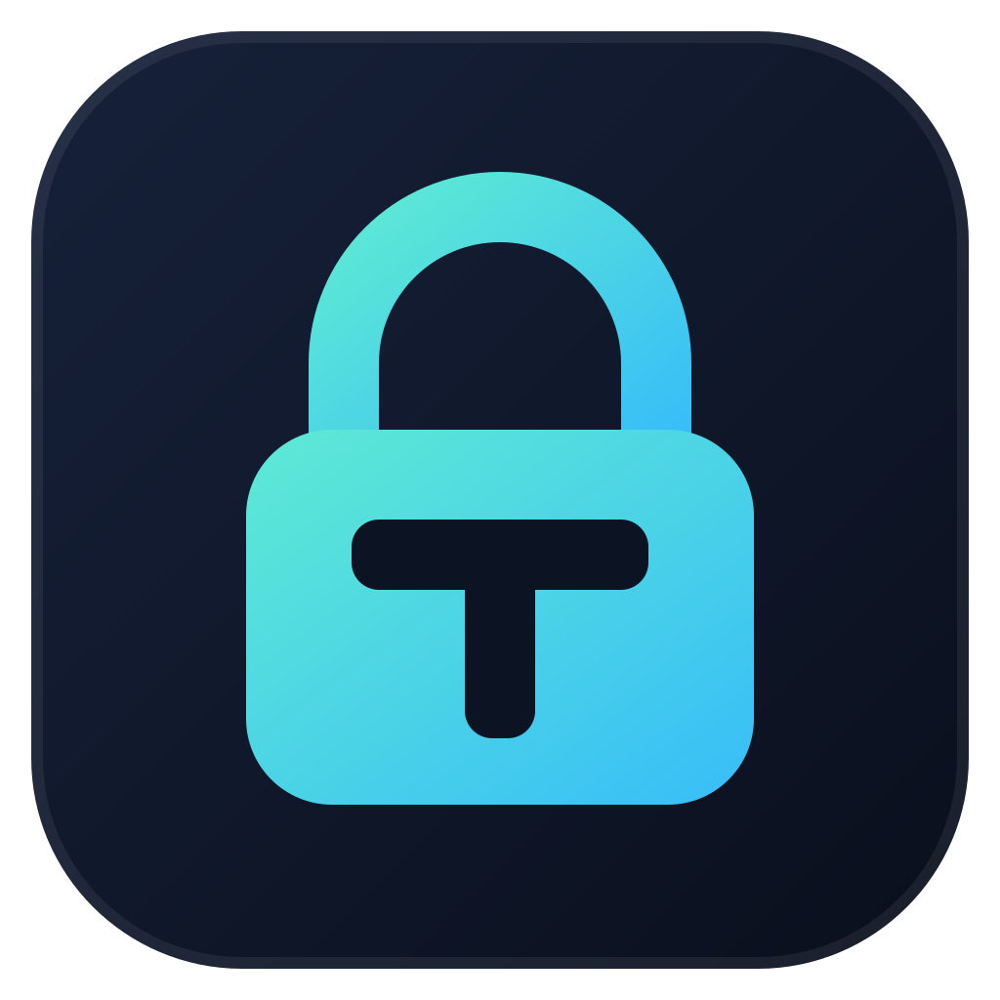
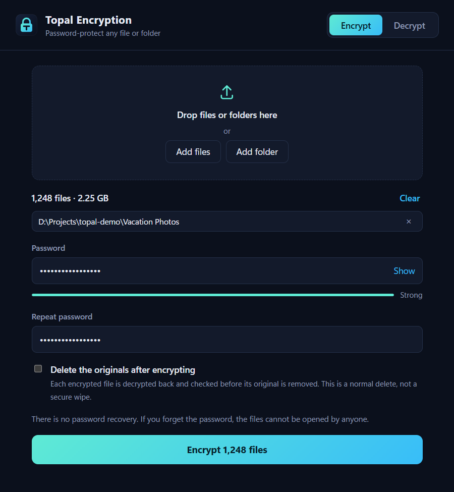

<div align="center">



# Topal

**Password-protect any file or folder on Windows.**

Photos, videos, documents, anything. Drop it in, type a password, done.
Without the password, nobody can open the files. Not even you.

[](https://github.com/abboodan/topal/actions/workflows/ci.yml)
[](LICENSE)
[](https://github.com/abboodan/topal/releases/latest)



</div>

## Features

- **Any file, any size.** Files are streamed in 1 MB chunks, so a 50 GB video uses the same couple of megabytes of memory as a text file.
- **Whole folders at once.** Drop a folder with thousands of files: the password is processed once for the whole batch and files are encrypted in parallel on every CPU core.
- **Safe to interrupt.** Each output is written to a temporary file and renamed into place only when complete. Cancel, crash or power loss never leaves a half-written file, and running again picks up where it stopped.
- **Your originals stay** unless you tick the box. If you do, each encrypted file is decrypted back and checked before its original is removed.
- **Tamper-evident.** A flipped bit, a truncated file or a swapped block is detected and reported instead of producing garbage.
- **Small.** The installer is about 2 MB. No account, no network access, no telemetry.

## Download

Get the latest build from the [Releases page](https://github.com/abboodan/topal/releases/latest):

| File | What it is |
|---|---|
| `Topal_x.y.z_x64-setup.exe` | Installer for the desktop app |
| `Topal.exe` | Portable desktop app, no installation |
| `topal-cli.exe` | Command-line tool |

The builds are not code-signed, so Windows SmartScreen may warn on first launch
(**More info → Run anyway**). The desktop app needs the WebView2 runtime, which ships with
Windows 10 and 11.

## Usage

### Desktop app

1. Choose **Encrypt** or **Decrypt**.
2. Drop files or folders onto the window (or use **Add files** / **Add folder**).
3. Type the password and press the button.

Encrypting `photo.jpg` creates `photo.jpg.topal` next to it. Decrypting does the reverse.

### Command line

```
topal-cli encrypt "D:\Vacation Photos"
topal-cli decrypt "D:\Vacation Photos"
topal-cli encrypt report.pdf video.mkv --delete-source
```

| Option | Meaning |
|---|---|
| `--delete-source` | Delete each source once its output is written and verified |
| `--force` | Overwrite outputs that already exist instead of skipping them |
| `-j, --jobs <N>` | Files processed in parallel (default: all CPU cores) |

The password is prompted for without echo. For scripts, set `TOPAL_PASSWORD` instead.

## How it works

Topal invents no cryptography. It combines standard, well-studied primitives from the
[RustCrypto](https://github.com/RustCrypto) project:

| Step | Primitive |
|---|---|
| Password → key | **Argon2id**, 256 MiB, 3 passes, 4 lanes, random 16-byte salt |
| Key wrapping and content | **XChaCha20-Poly1305** (256-bit key, authenticated) |
| Large files | **STREAM** construction: 1 MiB chunks, each bound to its position |

```
password ──Argon2id──▶ key-encryption key ──unwraps──▶ random per-file key ──▶ file content
```

- Argon2id makes every password guess cost about a second and 256 MiB of memory, which is
  what makes brute-forcing a decent password impractical even on GPUs.
- Every file gets its own random 256-bit key. The password-derived key only wraps that key.
- A batch shares one salt, so 10,000 files cost one key derivation rather than 10,000. Each
  `.topal` file is still fully self-contained and decrypts on its own.

### File format (version 1)

All integers are little-endian.

| Offset | Size | Field |
|---:|---:|---|
| 0 | 5 | Magic `TOPAL` |
| 5 | 1 | Format version (`1`) |
| 6 | 12 | Argon2id memory (KiB), passes, lanes |
| 18 | 16 | Argon2id salt |
| 34 | 4 | Plaintext chunk size |
| 38 | 19 | Stream nonce prefix |
| 57 | 24 | Key-wrap nonce |
| 81 | 48 | Per-file key, wrapped (32 bytes + 16-byte tag) |
| 129 | … | Encrypted chunks, each chunk size + 16-byte tag |

Bytes 0–56 are authenticated as associated data of the wrapped key, so the header cannot
be altered without the file being rejected.

## Security notes

Please read these before trusting Topal with data you cannot afford to lose.

- **There is no password recovery.** A forgotten password means the data is gone. That is
  the point of the design, not a missing feature.
- **Your password is the weak link.** The encryption is only as strong as the password.
  Use a long passphrase.
- **File names, sizes and folder structure are not hidden.** `tax-2025.pdf` becomes
  `tax-2025.pdf.topal`. Only the content is encrypted.
- **Deleting originals is not a secure wipe.** It is a normal delete; on SSDs in particular,
  deleted data can remain recoverable. For data that must not be recoverable, use full-disk
  encryption (BitLocker) underneath.
- **Topal has not had an independent security audit.** The primitives are standard and the
  format is documented above, but the code is young. Review is welcome.
- Topal protects files at rest. It cannot protect against malware already running on your
  PC while you type the password.

Found a vulnerability? Please report it privately through
[GitHub security advisories](https://github.com/abboodan/topal/security/advisories/new).

## Build from source

Requirements: [Rust](https://rustup.rs) (stable), the Visual Studio C++ build tools, and
[Node.js](https://nodejs.org) for the desktop app.

```
git clone https://github.com/abboodan/topal
cd topal

cargo test                         # run the test suite
cargo build --release -p topal     # CLI      -> target/release/topal-cli.exe

cd gui
npm install
npx tauri build                    # app      -> target/release/Topal.exe
                                   # installer -> target/release/bundle/nsis/
```

### Project layout

| Path | Contents |
|---|---|
| `core/` | `topal-core`: file format, streaming cipher, batch engine, tests |
| `cli/` | `topal-cli` command-line tool |
| `gui/src-tauri/` | Desktop app backend ([Tauri](https://tauri.app)) |
| `gui/ui/` | Desktop app interface (plain HTML, CSS and JavaScript) |

## License

[MIT](LICENSE)
